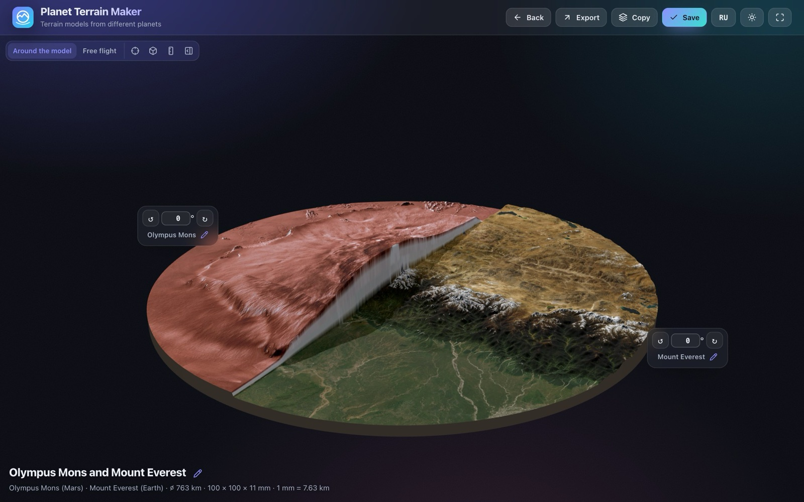
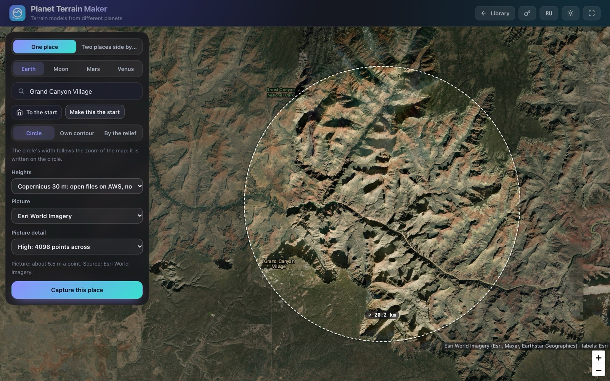
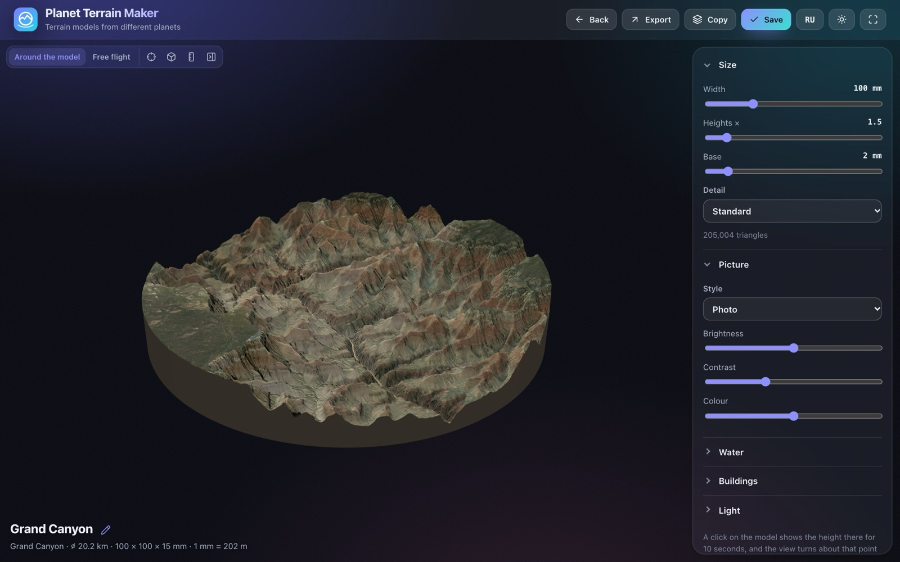
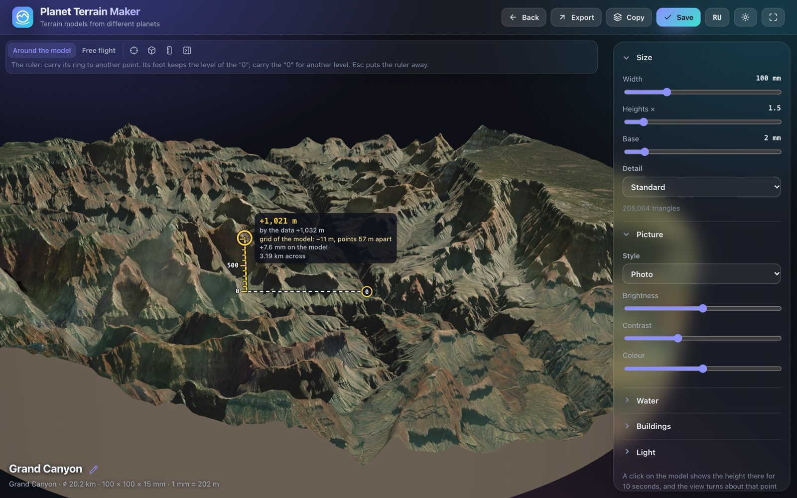
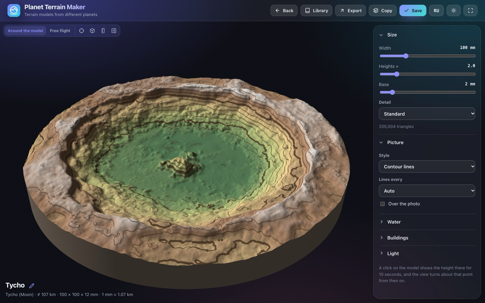
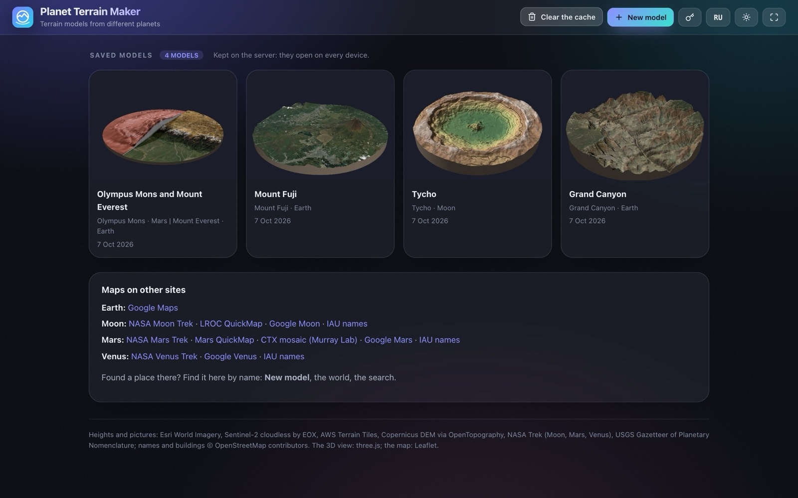

# Planet Terrain Maker

Make a solid 3D model of any place on Earth, the Moon, Mars or Venus: to look at on screen, to print
on a 3D printer, or to stand on your table in AR. Two places from any worlds can share one round
model at the same scale: a lunar crater next to Mount Elbrus, Olympus Mons next to Everest.

It is self-hosted: a small Python server and a single page, with no build step and no accounts. The
server relays the map tiles, heights and names the page needs, keeps the models you save, and serves
the same library to every device on your network.



## What it does

- **Four worlds.** Earth: pictures from Esri World Imagery, Sentinel-2 cloudless 2025 (EOX, 10 m) or
  USGS aerial photos (the USA, about 1 m); heights from Copernicus DEM 30 m read straight from AWS Open
  Data (no key; only the parts of the files a place needs are read), AWS Terrain Tiles, or Copernicus
  through OpenTopography (a free key). The Moon: SLDEM2015 (59 m) or LRO LOLA (118 m) heights, Kaguya
  (21 m) or LRO WAC pictures. Mars: HRSC-MOLA heights (200 m), Viking MDIM 2.1 colour, THEMIS day
  infrared, or the 5 m CTX mosaic of the Caltech Murray Lab. Venus: Magellan topography and its radar
  mosaics.
- **Find a place.** Towns and addresses on Earth (Nominatim), and every name the IAU has adopted on
  the Moon, Mars and Venus (`web/data/*-names.json`, built by `tools/planet_names.py`). With the field
  empty, the search lists the places you found last on this device and the largest named features.
  On the Moon, Mars and Venus a second search finds the landers and rovers by name or by year, and
  marks where they landed.
- **Frame it** with a circle whose width follows the map's zoom, a contour drawn on the map (sharp or
  smooth corners), or **By the relief**: an edge that follows the nearest ridge or valley around the
  circle (`terrain-edge.js`; the idea is the "Terrain edge" of Minimap Maker by Mike Jenkin).
- **The model** is one closed solid: the ground inside the outline, walls straight down and a flat
  bottom (`terrain-mesh.js`, marching squares on the heights grid). Width 30 to 300 mm, heights
  stretched up to 10 times, a base of 1 to 10 mm under the lowest point, three levels of detail.
- **The picture on top**: the photo, contour lines over colours of height, watercolour, painterly
  (Kuwahara), pencil sketch (XDoG) or three tones, drawn on the graphics card (`styles.js`). Water
  below a level is coloured by its depth; with **Calm water** the model's ground is flat there too, for
  printing. Buildings come from OpenStreetMap for places on Earth up to about 10 km across.
- **Two places side by side.** A guide frames the first place, takes its picture and heights and shows
  it in 3D; on its relief you draw the dividing line, straight through the centre or through points of
  your own, and a smooth curve follows them. Then the second place is found on the map in the same
  shape, turned as you like, with its own picture and heights. Afterwards each part can be turned and
  raised, and the heights stand either each from sea level or with the lowest points level.
- **Look around.** Around the model: drag to turn, a click shows the height there and makes that point
  the centre the view turns about. Or **free flight** (`fly-camera.js`), with the weight of a bird or
  a plane: it gathers speed, glides on, leans into turns and lifts its nose in a climb.
- **Asteroids at their real size** on a model of one place (`asteroid-on-model.js`): the asteroid button
  in the camera bar lists the ten most exact shapes, from Itokawa (535 m) to Ceres (946 km), taken by
  spacecraft and radar, and finds any of about 8,800 more in the DAMIT catalogue by name or number
  (`asteroid-search.js`). Put as many as you like: one put without a new click stands beside the last,
  so they compare. Each stands on the ground or hangs over it at a height you set for the one chosen
  (its name in the row under the camera bar, or a click on it); its label carries it over another point,
  and while it moves its projection shows on the ground with its height over it. A click on one makes
  the view turn about it. A saved model keeps its asteroids, where they stood and as high. The shapes
  are fetched by the server the first time and kept (`app/asteroids.py`); the lists are made by
  `tools/asteroids.py`.
- **Check the heights** with a ruler carried across the model (`height-ruler.js`). Its foot stays at
  the level of its "0"; beside its top it reads the height above the zero on the model and in the
  data, and says why the two differ: a place raised on the model, calm water, or the model's grid.
- **Files**: STL and 3MF (one closed solid in millimetres, for any slicer), GLB, OBJ (a zip with its
  materials and picture), USDZ (at real size, for AR Quick Look on an iPhone or iPad), a PNG of the
  view, and a video of one turn around the model (MP4 where the browser records it, else WebM).
- **A library on the server**: a model saved on a computer opens on a phone. Cards show the model as
  it was on screen when it was saved; a model can be copied and renamed, and a name made of its places'
  names renames the places too.
- **Your own picture source** on Earth: the tiles of any service that lets a page read them (an HTTPS
  XYZ address) become the model's picture, at the guide's picture step or later in the model's panel.
  Coming close to the model in the Photo style loads the service's finer tiles for the part in view.
- **English and Russian**, light and dark themes, phones and tablets.

| Frame a place on the map… | …and it becomes a solid model |
|---|---|
|  |  |
| **The height ruler**, from the river to the rim | **Contour lines** over the colours of height: Tycho on the Moon |
|  |  |



## Run it

With Docker:

```bash
docker compose up -d --build
```

Then open http://localhost:8080. The library, the tile cache and the settings stay in the volume
`ptm-data`.

From the source, with Python 3.13:

```bash
python3 -m pip install -r requirements.txt
APP_PORT=8080 python3 -m app
```

| Variable | Default | What it sets |
|---|---|---|
| `APP_HOST` | `127.0.0.1` | the address the server listens on |
| `APP_PORT` | `15002` | its port |
| `APP_DATA` | `./data` | where the library, the caches, the settings and the key are kept |
| `TILE_CACHE_MB` | `4096` | the most the tile cache keeps on disk |
| `OPENTOPO_KEY` | none | an OpenTopography key for Copernicus heights (it can also be set on the page) |
| `APP_USER_AGENT` | `planet-terrain-maker/1.0` | how the server introduces itself to Nominatim, Overpass and the tile services: add a way to reach you |

There is no sign-in: every route is open to whoever reaches the server. Run it on a private network,
or behind a reverse proxy of your own that signs people in.

## Using it

- **New model** opens the map, where **One place** or **Two places side by side** is chosen. A guide
  leads through the steps: for one place, frame it, choose its picture, choose its heights and build it;
  for two places, the same for each, with the dividing line drawn between them. The guide floats over
  the map without moving it, and on Earth the map shows Sentinel-2 cloudless 2025 while a place is
  framed. **Make this the start** keeps where a world's map opens, for every device.
- **The camera bar** over the model: **Around the model** and **Free flight**, then **To the centre**,
  **Whole model**, the **Height ruler**, the **Asteroid** button and the panel. Around the model the
  wheel or two fingers come as close as a twelfth of the model's width, and R and F move the camera up
  and down.
- **Free flight**: the mouse looks; W and S (or ↑ and ↓) fly forward and back, A and D (or ← and →)
  turn, Q and E slide, Shift climbs and Ctrl descends, R and F tilt the view, Space (or **Level**)
  brings it back to the horizon. Two short quick taps of a key hold its move on; one more press, or a
  press of the opposite key (S for W, D for A), lets it go. Each action has its own speed slider; **Save
  as my set** keeps your speeds on the server for every device. On a phone one finger looks and two
  fingers pinch and slide.
- **The height ruler**: its ring is its top, carried to another point; its "0" is carried the same way
  to another level. Arrow keys move a focused end; Esc puts the ruler away. The ruler is drawn over the
  view, so no picture, video or file has it.
- **Your own picture source**: choose **Custom picture source** at the picture step, or **Picture →
  Custom picture source** in the model's panel, and paste an HTTPS tile address with `{z}`, `{x}` and
  `{y}`. The tiles must be 256 pixels in Web Mercator, from a service that allows cross-origin requests
  (CORS). The name, the credit and the deepest zoom come from the service's WMTS description or from a
  test at the place; **Additional settings** change them. **Apply to the model** replaces the picture
  without fetching the heights again; on a model of two places on Earth you choose which place gets it.
  The field offers the addresses used before, kept on the server for every device; **Forget URL** drops
  the address and keeps the picture. The tiles never show on the 2D map. A saved model keeps its
  picture and credit, so it opens without the address; the service's terms still apply to the picture.
- **Close-up detail** of your own picture source, in the Photo style: only the tiles in view are loaded,
  up to the service's deepest zoom, and the server keeps them (`data/picture-tiles`) for the next visit.
  PNG, video and GLB carry the detail loaded in view; other styles, OBJ and USDZ use the overview
  picture, and STL and 3MF are the shape alone.
- **Tablets** take pictures of at most 4096 points a side: a model of two places holds three pictures
  that big, more than a tablet's graphics memory. A saved picture larger than that comes to the tablet
  as a smaller copy made by the server, and the file itself stays as it was.
- **Clear the cache** on the library screen clears this site's cache in this browser only: the tiles,
  pictures and page files. The models and the choices kept on the device stay.
- **Errors of the page** go to the server's log, and the last 300 are kept to read from any device: `GET
  /api/client-errors`. Those from a browser a test program drives are marked `automated`.

## How it is built

The server (`app/`, Flask) serves the page and relays the built-in data sources. Your own picture
sources are the exception: the browser reads their tiles itself, over HTTPS with CORS and without
cookies, and the server never fetches an address a user typed:

| Module | What it does |
|---|---|
| `tiles.py` | map tiles of every world through `/api/tile/...`, kept on disk (`data/cache/tiles`, at most `TILE_CACHE_MB`) |
| `copdem.py` | Copernicus DEM from AWS Open Data: Cloud Optimized GeoTIFFs read by range, inflated and un-predicted with numpy, kept on disk |
| `earth.py`, `grids.py` | Copernicus heights from OpenTopography as a float32 grid |
| `planets.py` | the Moon's, Mars's and Venus's heights and pictures from NASA Trek (and SLDEM2015) |
| `places.py` | Nominatim search and place names, one request a second, answers kept |
| `buildings.py` | OpenStreetMap buildings through Overpass, mirrors in turn, answers kept |
| `pictures.py` | smaller copies of saved pictures for devices that hold less (`?most=4096`) |
| `asteroids.py` | asteroid shapes from NASA, JAXA, the PDS radar models and DAMIT, fetched once and kept on disk (`data/cache/asteroids`) |
| `library.py` | the saved models in `data/models`; removed ones wait 30 days in `data/trash` |
| `keys.py` | the OpenTopography key, set on the page and kept in `data/keys` (mode 600), never sent back |
| `settings.py` | where each world's map opens and your set of flight speeds, the same on every device |
| `picture_sources.py` | user-entered source history in `data/picture-sources.json`, outside git, shared between devices |
| `detail_tiles.py` | close-up tiles of your own picture sources, sent by the browser, checked and kept in `data/picture-tiles` |
| `apispec.py` | `/openapi.json` from the routes, and `docs/http-api.md` from it |
| `packages.py` | what this copy runs on, for a check of known vulnerabilities (`GET /api/packages`) |

The page (`web/`) is ES modules with no build step. `ui.css`, `ui.js` and `theme.js` hold the base
look and a few small tools; `style.css` and `web/js/` hold the app. three.js 0.186.1 and Leaflet
1.9.4 are copied into `web/vendor` by `npm run vendor`.

A capture (`capture.js`) lays the heights and the picture into the place's own flat frame: metres
east and north of its centre (`geo.js`), whatever the source's projection. The model (`model.js`)
composes two places (`split.js`), the mesh is built from it (`terrain-mesh.js`), and the files are
written from the mesh (`exporters.js`, `export-scene.js`).

## Develop

```bash
npm ci && npm test                                    # the page's code (node --test)
python3 -m pip install -r requirements.txt
npm run test:py                                       # the server
python3 -m app.apispec > docs/http-api.md             # after a change of the API (a test checks they agree)
```

The HTTP API is described at `/openapi.json` and in [docs/http-api.md](docs/http-api.md).

`GET /api/packages` lists what a running copy is made of: its Python libraries, the page's libraries
and the system's packages, each named as [osv.dev](https://osv.dev) names it. Send them to osv.dev's
`/v1/querybatch` as they are to learn which have known vulnerabilities.

## Data and credits

Esri World Imagery (Esri, Maxar, Earthstar Geographics); Sentinel-2 cloudless 2025 by EOX (contains
modified Copernicus Sentinel data 2025, CC BY-NC-SA 4.0: non-commercial use only); USGS The National
Map orthoimagery (USDA NAIP); AWS Terrain Tiles; Copernicus DEM GLO-30 and GLO-90 (ESA, through AWS
Open Data and OpenTopography); NASA Moon, Mars and Venus Trek (LRO, Kaguya/JAXA, Viking, HRSC-MOLA,
Magellan); SLDEM2015 (NASA/GSFC, JAXA); the Caltech Murray Lab CTX mosaic; USGS Gazetteer of
Planetary Nomenclature; OpenStreetMap contributors (Nominatim, Overpass). Asteroid shapes: NASA 3D
Resources (OSIRIS-REx, Hayabusa, NEAR Shoemaker, Dawn); JAXA Hayabusa2 (Ryugu, Watanabe et al. 2019);
the PDS Small Bodies Node radar shape models (Hudson, Ostro et al.); DAMIT, the Database of Asteroid
Models from Inversion Techniques (Ďurech et al. 2010, CC BY 4.0); diameters from JPL's Small-Body
Database. Models made from them follow each provider's terms. three.js and Leaflet: MIT and BSD licences (`web/vendor/*/LICENSE`).

## License

The code is under the MIT License ([LICENSE](LICENSE)). The maps, pictures and heights it fetches
keep their own terms, listed above.
